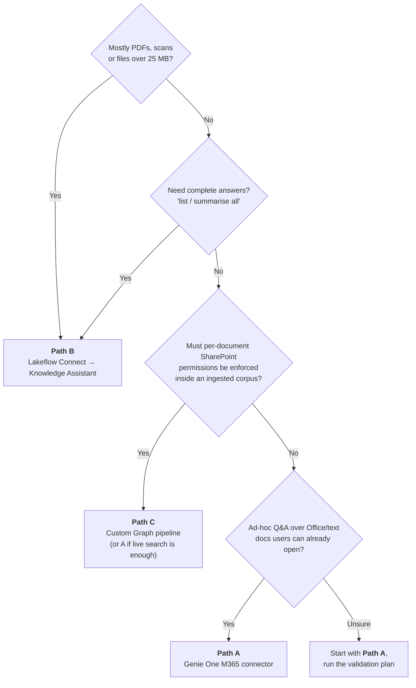
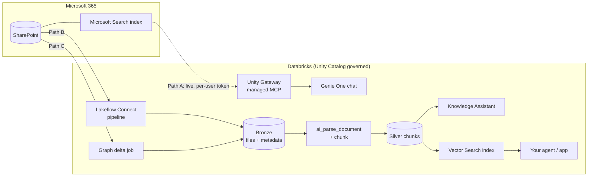
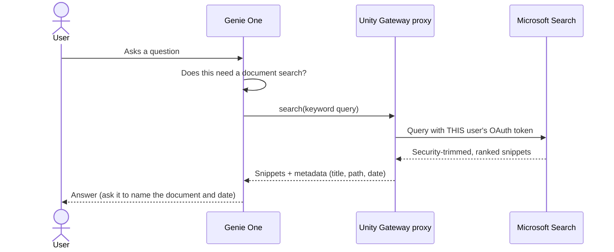

<div align="center">

# Genie & Microsoft 365 / SharePoint on Databricks

**A step-by-step engineering guide, with working code, for connecting SharePoint and Microsoft 365 to Databricks.**
Three integration paths · how to choose · how to run it in production.


[Choose a path](#-choose-your-path) ·
[Quick start](#-quick-start) ·
[Path A](#path-a--genie-one-microsoft-365-connector) ·
[Path B](#path-b--lakeflow-connect-sharepoint-ingestion) ·
[Path C](#path-c--custom-microsoft-graph-pipeline) ·
[Operate](#-operate-it-in-production) ·
[What's tested](#-what-has-been-tested)

</div>

---

> [!NOTE]
> Capabilities, limits and release statuses were verified against Databricks and Microsoft documentation on **6 October 2026**. They change often. Re-check the [linked documentation](#-references) before production sign-off.

## The 30-second answer

**Genie One can search SharePoint directly, with no ingestion and no vectorisation.** It is search-in-place, not a RAG pipeline: excellent for *"find me the current policy on X"*, but it cannot read PDFs or files over 25 MB and returns top-ranked snippets rather than complete lists. For large or PDF-heavy libraries, ingest with Lakeflow Connect into a governed Knowledge Assistant. **Most teams run both.**

| | **Path A** · Genie One M365 connector | **Path B** · Lakeflow Connect ingestion | **Path C** · Custom Graph pipeline |
|---|---|---|---|
| **Pattern** | Live search-in-place | Managed incremental ingest → RAG | Your own code → RAG |
| **Data stays in** | SharePoint (zero-copy) | Unity Catalog Delta tables | UC Volumes + Delta |
| **Permissions** | ✅ Per-user, live | ⚠️ UC grants (SharePoint ACLs **not** ingested) | ✅ UC grants + ACLs you capture |
| **PDFs / scans** | ❌ | ✅ | ✅ |
| **Complete answers** | ❌ top hits only | ✅ | ✅ |
| **Setup** | Minutes | Hours | Days |
| **Use it for** | Ad-hoc Q&A | Persistent RAG at scale | Per-document ACL trimming |

---

## 🧭 Choose your path



> [!TIP]
> **Recommended for most teams: run A and B together.** Switch on A now for everyday questions (no build), and ingest the curated, high-value, PDF-heavy libraries with B. Use C only where B cannot meet a specific requirement.

### How the pieces fit



### Release status (6 October 2026)

| Capability | Status | Notes |
|---|---|---|
| Genie One Microsoft 365 connector | **GA** · 10 Sep 2026 | Runs through Unity Gateway, so only in Unity Gateway-supported regions. Per-user OAuth |
| Lakeflow Connect SharePoint (managed) | **GA** · 4 Aug 2026 | `LIST` entities and structured-file ingestion are still **Beta**. `BINARYFILE` is the production path for PDFs and Office files |
| `ai_parse_document` | **GA** · 16 Apr 2026 | 100 MB and 500 pages per document. Region-limited |
| Agent Bricks Knowledge Assistant | **GA** | Up to 10 knowledge sources. Region-limited |
| Vector Search (AI Search) | **GA** | Region-limited. Only needed for the custom-RAG variant |
| Terraform `databricks_pipeline` for SharePoint | ⚠️ Known provider gap | Use the Asset Bundle in this repo (or the Pipelines REST API) |

### What this means for very large libraries (e.g. 65,000 documents)

- **Path A needs no vectorisation.** Microsoft already indexes the library; the connector reuses that index. Library size creates no work for you.
- **But it is search, not browse.** Only the top-ranked slice reaches the model, as snippets rather than full documents. PDFs, images, binaries and files over 25 MB are invisible, and a just-uploaded file may not appear until Microsoft indexes it.
- **Path B scales, with planning.** There is no documented hard item limit. Plan for a long first backfill (hours, not minutes), run it off-peak so Graph throttling does not hurt other apps in the tenant, and remember the connector ingests **everything** under the URL you give it. You cannot select individual files.

---

## ⚡ Quick start

| I want to… | Do this | Time |
|---|---|---|
| Try it today, no build | [Path A](#path-a--genie-one-microsoft-365-connector) | ~30 min |
| Stand up production RAG over SharePoint | [Prerequisites](#-before-you-start) → [Path B](#path-b--lakeflow-connect-sharepoint-ingestion) → [Serve the data](#-serve-the-ingested-data) | ~½ day + consent wait |
| Need per-document permission trimming | Path B steps 1–3 → [Path C](#path-c--custom-microsoft-graph-pipeline) | days |
| Prove it works before committing | [Validate](#-validate-before-you-roll-out) and the [smoke test](tests/README.md) | ~1 hr |

```bash
git clone https://github.com/jason-miles/Genie-and-M365-SharePoint-Integration.git
cd Genie-and-M365-SharePoint-Integration
./scripts/preflight.sh          # checks terraform, databricks CLI, az, python3
```

---

## 📦 Repository layout

```text
.
├── terraform/                      Entra app · secrets · Unity Catalog · grants · Vector Search
│   ├── entra.tf                    Entra app (Sites.Selected) + client secret + admin consent
│   ├── databricks.tf               secret scope, catalog, schemas, volume, grants
│   ├── vector_search.tf            endpoint + Delta Sync index (index gated by a variable)
│   └── variables.tf  outputs.tf  versions.tf  terraform.tfvars.example
├── bundle/                         Databricks Asset Bundle
│   ├── databricks.yml              variables and targets
│   ├── resources/
│   │   ├── option_b.yml            Lakeflow Connect pipeline + nightly job
│   │   └── option_c.yml            custom Graph job
│   └── notebooks/
│       ├── 01_graph_delta_ingest.py              Path C · Graph delta + ACL capture
│       ├── 02_parse_and_chunk.sql                Path B · incremental parse + chunk
│       ├── 02b_parse_and_chunk_from_volume.sql   Path C · incremental parse + chunk
│       ├── 03_sync_vector_index.py               trigger the Vector Search sync
│       ├── lib_secure_search.py                  secure_search() · security-trimmed retrieval
│       ├── 04_monitoring_queries.sql             alert queries
│       └── 99_e2e_smoke_test.py                  asserting end-to-end test
├── scripts/                        preflight · get_site_id · grant_site_access
└── tests/                          synthetic corpus generator + smoke-test guide
```

> [!IMPORTANT]
> **Division of labour.** Terraform owns Entra, secrets, Unity Catalog, grants and Vector Search. The Asset Bundle owns the ingestion pipeline, jobs and notebooks. The split is deliberate: the Terraform provider cannot yet create the SharePoint ingestion pipeline cleanly, and `databricks_connection` does not list a SharePoint type, so the **Unity Catalog connection is created once in Catalog Explorer**.

---

## ✅ Before you start

### Region check (do this first)

Several services are region-gated, and this decides where you build.

| Service | Needed for | Check that… |
|---|---|---|
| Unity Gateway | Path A | your workspace region is on the supported list |
| `ai_parse_document` | Paths B, C | the region is marked available (v2) |
| Knowledge Assistant | Paths B, C | the region is available, and whether it needs cross-geo processing |
| Vector Search (AI Search) | Paths B, C (custom RAG) | the region is available |

See [Features with limited regional availability](https://docs.databricks.com/aws/en/resources/feature-region-support). If your data-protection rules restrict where inference may run, record that decision once and apply it to every workload here.

### Prerequisites

| Requirement | Owner | Paths |
|---|---|---|
| Unity Catalog workspace with serverless compute | Databricks admin | A, B, C |
| Genie One enabled; users have at least consumer access | Workspace admin | A |
| M365 Global / Privileged Role admin available for **tenant-wide admin consent** | M365 / Entra admin | A, B, C |
| Entra Conditional Access reviewed (CA, MFA, IP policies can silently block OAuth) | Security | A |
| `CREATE CONNECTION` on the metastore | Metastore admin | B |
| `USE CATALOG` and `CREATE SCHEMA` on the destination catalog | Data platform | B, C |
| 3–5 pilot users from different security groups | Project lead | A |

> [!TIP]
> Book the Entra admin on day one. Waiting for tenant-wide consent is the most common source of delay.

---

## Path A · Genie One Microsoft 365 connector

**Zero-copy · per-user permissions · about 30 minutes · no code.**



### Steps

1. **Enable the connection** *(workspace admin)*. Confirm *Microsoft 365* appears under Genie One external sources. If not, check the workspace **Previews** page and your region's Unity Gateway support.
2. **Grant tenant consent** *(M365 admin)*. The connector requests Graph scopes such as `Sites.Read.All`, `Files.Read.All`, `User.Read` and `offline_access`, plus Teams/Outlook/Calendar scopes if those surfaces are enabled. Scopes ending in `.All` need an admin to consent once for the organisation. The consent screen is the authoritative list.
3. **Govern it in Unity Catalog.** The connection is a UC object. Metastore admins and connection owners control who may use it; changing permissions forces users to re-authenticate.
4. **Users sign in.** In Genie One click **+** next to the search bar → **Microsoft 365** → **Sign in**. Each user authenticates once with their own identity; tokens are never shared.
5. **Pilot.** Run the [20-question test set](#-validate-before-you-roll-out) with 3–5 users from different security groups, including at least one restricted HR or finance document to prove ACL trimming.
6. **Publish user guidance:** *"Say 'use SharePoint' if Genie does not search; ask for the document name and date; PDFs are not searchable through this path."*

> [!WARNING]
> **What Path A cannot see:** PDFs, images and other binaries, files over 25 MB, and anything Microsoft has not yet indexed. Tell pilot users on day one so a "not found" is not mistaken for a failure.

<details>
<summary><b>Use it from your own agents or apps</b></summary>

The same managed service is available as `system.ai.microsoft_365`. Callers need `EXECUTE` on the service plus `USE CATALOG` and `USE SCHEMA` on its parents. A Databricks App declares `user_api_scopes: [ai-gateway]` and calls the service with the per-user client, so requests run on behalf of the signed-in user.

</details>

<details>
<summary><b>Keeping Path A accurate</b></summary>

1. **Scope what users search** (the right sites and libraries). The biggest precision lever.
2. **Add Genie instructions** that say when to search SharePoint and how to phrase queries.
3. **Clean up SharePoint search:** good titles, managed metadata, promoted/best-bet results for canonical documents.
4. **Remove superseded versions and duplicates.** Stale copies are the number one cause of wrong answers.
5. **Keep content in supported formats under 25 MB.** Keep a `.docx` or `.md` companion for key PDFs.
6. **Make verification a habit:** always ask Genie to name the document and date it used.

</details>

**Done when:** pilot users can sign in, the 20-question run is scored, and a restricted document never surfaces for an unauthorised user.

---

## Path B · Lakeflow Connect SharePoint ingestion

**Managed · incremental · governed by Unity Catalog · about half a day, most of it waiting on consent.** Steps 1–3 are shared with Path C.

### Step 1 · Choose the authentication method

| Method | Use when | Watch out for |
|---|---|---|
| **OAuth M2M** (service principal) | Unattended production pipelines. **Recommended** | Client-secret expiry; rotate at least every 180 days |
| OAuth U2M, Databricks-managed | Proof of concept | Ties the pipeline to one person's identity; refresh tokens expire after 90 days by default |
| OAuth U2M, custom-managed | You need your own app ownership or control over API rate limiting | More setup |
| Manual token refresh | Avoid for new work | Legacy; prone to `invalid_grant` |

This repo implements **M2M with `Sites.Selected`** (least privilege).

### Step 2 · Create the Entra app, secrets and Unity Catalog objects

```bash
cd terraform
cp terraform.tfvars.example terraform.tfvars    # set databricks_host and tenant_id
az login                                        # identity able to create Entra apps + consent
terraform init && terraform plan && terraform apply
```

Creates: the Entra app with the `Sites.Selected` **application** permission and admin consent · a client secret (180-day lifetime) stored **only** in the Databricks secret scope `m365-sharepoint` · the `m365` catalog, `sharepoint_bronze` / `sharepoint_silver` schemas, a managed `raw_files` Volume and grants (including `USE_CATALOG`) · a Vector Search endpoint.

> [!CAUTION]
> Secret values pass through Terraform state. Use an encrypted remote backend with tight access, or create the secret out of band.

<details>
<summary>Manual alternative (no Terraform)</summary>

Entra ID → App registrations → **New registration** → Certificates & secrets → **New client secret** → API permissions → Microsoft Graph → **Application permissions** → `Sites.Selected` → **Grant admin consent**. (Broader, not recommended: `Sites.Read.All` + `Files.Read.All`.)

</details>

### Step 3 · Grant the app read access to each site

`Sites.Selected` grants nothing by itself. For every in-scope site:

```bash
./scripts/get_site_id.sh <tenant>.sharepoint.com /sites/<SiteName>          # find the Graph site ID
./scripts/grant_site_access.sh <site-id> "$(terraform -chdir=terraform output -raw entra_client_id)"
```

> [!IMPORTANT]
> Run the grant as an **admin identity** allowed to grant site permissions (for example an app holding `Sites.FullControl.All`, used once and then removed). The ingestion app cannot grant itself access. Keep the granted-sites list in version control and review it quarterly.

### Step 4 · Create the Unity Catalog connection

In Catalog Explorer: **Create connection** → type **Microsoft SharePoint** → auth **OAuth Machine to Machine** → Client ID, Client secret, **Domain** `https://<tenant>.sharepoint.com`, **Tenant ID** → name it `sharepoint_m2m` → grant `USE CONNECTION` to the pipeline-owner group only.

### Step 5 · Configure and deploy the ingestion pipeline

`bundle deploy` creates **every** resource listed under `include:` in `bundle/databricks.yml`. For Path B only, comment out the `resources/option_c.yml` line first (the Path C job needs a Graph site ID and would fail nightly).

```bash
cd bundle
VARS=(--var sharepoint_url="https://<tenant>.sharepoint.com/sites/<site>" --var ops_email="oncall@example.com")
databricks bundle validate -t dev --profile <profile> "${VARS[@]}"
databricks bundle deploy   -t dev --profile <profile> "${VARS[@]}"
databricks bundle run sharepoint_rag_option_b -t dev --profile <profile>     # first run, manually
```

> [!NOTE]
> In `dev` mode the bundle prefixes resource names with `[dev <you>]` and pauses schedules. Use `databricks bundle run <key>` rather than looking jobs up by name.

What the pipeline is (`bundle/resources/option_b.yml`):

```yaml
ingestion_definition:
  connection_name: sharepoint_m2m
  objects:
    - table:
        destination_catalog: m365
        destination_schema: sharepoint_bronze
        destination_table: sharepoint_files
        connector_options:
          sharepoint_options:
            entity_type: FILE
            url: https://<tenant>.sharepoint.com/sites/<site>
            file_ingestion_options:
              format: BINARYFILE
              schema_evolution_mode: NONE
```

<details open>
<summary><b>Behaviour to know</b></summary>

| Topic | Detail |
|---|---|
| Entity types | `FILE` (content + metadata) · `FILE_METADATA` (metadata only) · `LIST` (SharePoint lists, Beta) |
| Formats | `BINARYFILE`, `CSV`, `JSON`, `XML`, `EXCEL`, `PARQUET`, `AVRO`, `ORC`. Structured formats are Beta; use `BINARYFILE` for PDFs and Office files |
| Incremental | Later runs re-ingest only files updated since the last run. Changes *inside* a file are not applied incrementally |
| Deletes | `BINARYFILE` defaults to SCD Type 1, so changed or deleted files are updated or removed. SCD Type 2 is not supported |
| Scope | Everything under the URL (folder, drive, subsite or site). Scope the URL and use `file_filters` deliberately. Each filter object takes **one** key: `path_filter`, `modified_after` or `modified_before` |
| Metadata | Rows carry `_sharepoint_metadata` (site/drive IDs, creator, timestamps, MIME type). **Validate** field names with `DESCRIBE TABLE`. A `permissions` field may appear, but file-level SharePoint ACLs are **not** ingested; do not use it for access decisions |
| Files over 100 MB | Loaded into memory as one record and can fail the whole update. Filter them out with the `length` column (see the connector limitations page) and report them to content owners |
| Long backfills | Access tokens expire after a few hours. A very long first run may stop; it resumes where it left off without losing data but may need a manual restart. Run the first ingest off-peak |

</details>

Run the first ingest manually from the pipeline page before enabling the schedule.

### Step 6 · Parse and chunk

`02_parse_and_chunk.sql` (job task `parse_chunk`) parses binaries with `ai_parse_document` and writes `sharepoint_silver.parsed_docs` and `sharepoint_silver.chunks` (Change Data Feed on, required by Delta Sync indexes).

It is **incremental**:

- only new or modified documents are parsed (and billed);
- chunks of modified or deleted documents are removed first, so the index never serves stale text;
- a document the parser rejects keeps a row in `parsed_docs` with `error_status` set and produces no chunks (the monitoring notebook reports them).

Validate the `_sharepoint_metadata` field names first (`site_id` is the security scope). `ai_parse_document` accepts PDF, JPG/PNG, TIFF, DOC/DOCX and PPT/PPTX; other files need a different path.

➡️ Continue at [Serve the ingested data](#-serve-the-ingested-data).

---

## Path C · Custom Microsoft Graph pipeline

Use this **only** when Path B cannot meet a requirement: per-document ACL capture and trimming, custom metadata enrichment, cross-tenant sources, or very fine scheduling control. **Do Path B steps 1–3 first.** Capturing full permission hierarchies needs higher privilege than `Sites.Selected`, so review it with Security.

### How the pipeline works

1. Enumerate each document library (**drive**) with `GET /drives/{drive-id}/root/delta`, following `@odata.nextLink` until `@odata.deltaLink`, then persist the `deltaLink`. A site can hold several libraries, so this runs **per drive**.
2. On each run call the saved `deltaLink` to receive only creates, modifies and deletes (the `deleted` facet). On HTTP `410 Gone`, start a fresh enumeration.
3. **Track items by `id`, not path.** A folder rename does not return its descendants.
4. Capture ACLs with `GET /drives/{drive-id}/items/{item-id}/permissions` (the notebook sends `Prefer: hierarchicalsharing` so you can re-fetch only the roots of permission hierarchies).
5. Handle throttling: respect `Retry-After` on HTTP 429, use JSON batching, avoid polling loops. For one-off bulk extraction of very large tenants, evaluate Microsoft Graph Data Connect.
6. Land files in a UC Volume and metadata + ACLs in Delta tables.

### Steps

1. Find the site ID:
   ```bash
   ./scripts/get_site_id.sh <tenant>.sharepoint.com /sites/<SiteName>
   ```
2. For Path C only, comment out the `resources/option_b.yml` line in `bundle/databricks.yml` (it needs a SharePoint connection you will not have), then deploy:
   ```bash
   cd bundle
   databricks bundle deploy -t dev --profile <profile> \
     --var graph_site_id="<site-id>" --var ops_email="oncall@example.com"
   ```
3. **First load:** run with ACL capture off, which is much faster, then once more with it on:
   ```bash
   databricks bundle run sharepoint_rag_option_c -t dev --profile <profile> --params capture_acls=false
   ```
   The job runs `01_graph_delta_ingest.py` → `02b_parse_and_chunk_from_volume.sql` → `03_sync_vector_index.py`.
4. Tables created in `m365.sharepoint_bronze`: `files` (one row per item), `file_acls` (principals per item), `delta_state` (saved `deltaLink` per drive).

> [!WARNING]
> **Plan the first load for a large library.** The notebook downloads files one at a time, and ACL capture is one extra Graph call per changed item, so a first load of tens of thousands of files can take many hours and will meet throttling (HTTP 429, handled with `Retry-After`). Run it off-peak, use `capture_acls=false` first, and only add parallelism cautiously, since Graph throttles per app across your whole tenant. Later runs are incremental and small.

> [!NOTE]
> Paths B and C both write `sharepoint_silver.parsed_docs` and `chunks`. Run one corpus pipeline per silver schema, or point them at different catalogs/schemas.

➡️ Continue at [Serve the ingested data](#-serve-the-ingested-data).

---

## 🔎 Serve the ingested data

Pick one, or both, per security domain.

### Option 1 · Agent Bricks Knowledge Assistant *(fastest route to production RAG)*

Agent Bricks → **Knowledge Assistant** → add the ingested UC table (supported natively) or a UC Volume.

| Topic | Detail |
|---|---|
| Sources | 1–10 per assistant |
| File limits | Files over 100 MB or 500 pages are skipped; names starting with `_` or `.` are skipped |
| Table rules | Needs Change Data Feed or a streaming table, a `BINARY`/`STRING` content column and a metadata struct (path, name, size, modification time). The SharePoint connector produces this automatically |
| First sync | Can take a few hours; answers include citations |
| Permissions | `Can Query` / `Can Manage` |
| Editing sources | Only the creator can add/remove sources; `Can Manage` can sync and rename |

> [!WARNING]
> **Everyone who can query a Knowledge Assistant sees its whole corpus.** Build **one Knowledge Assistant per security domain** (for example Clinical, Finance, HR).

### Option 2 · Vector Search with your own agent

Create the index after the first job run has produced `sharepoint_silver.chunks`:

```bash
cd terraform && terraform apply -var create_vector_index=true
```

`03_sync_vector_index.py` then syncs it on every job run (`TRIGGERED` index, `databricks-gte-large-en` embeddings by default).

**Security-trimmed retrieval.** `lib_secure_search.py` provides `secure_search()`. Use it from your agent/app notebook with `%run ./lib_secure_search`, after `%pip install databricks-vectorsearch` and a Python restart. The package is **not** preinstalled on serverless; the bundle jobs declare it as an environment dependency.

| Level | How | Fails |
|---|---|---|
| **Site / library** | Map the caller's Entra groups to readable sites in a table you own (`<catalog>.sharepoint_silver.site_access`: `group_name`, `site_id`) and filter on `source_scope` | **Closed**: no mapping, no results |
| **Document** *(Path C only)* | Over-fetch, then drop any chunk whose `item_id` has no `file_acls` row for the caller's principals | Closed |

You own the `site_access` mapping (for example refreshed nightly from Entra group membership and your `Sites.Selected` grant list).

---

## 🧪 Validate before you roll out

Run the **same question set** through Path A and Path B (or C) and let the numbers decide. For the engineering half, [`99_e2e_smoke_test.py`](bundle/notebooks/99_e2e_smoke_test.py) asserts retrieval and security behaviour automatically ([guide](tests/README.md)).

| # | Activity | Success criteria |
|---|---|---|
| 1 | Pick one representative library and profile it: file types, size bands, duplicates | Know the % of PDF and over-25 MB files (content Path A cannot see) |
| 2 | Write 20 gold questions: **8** targeted · **4** multi-document · **4** exhaustive · **4** restricted-access | Each has a known answer and source |
| 3 | Run them through Genie One + the M365 connector with 3 pilot users from different groups | Record hit/miss, source, latency |
| 4 | Run the same questions through Knowledge Assistant over the ingested library | Same metrics plus citation accuracy |
| 5 | Compare | Path A ≥ 85% on targeted lookups → adopt for ad-hoc; Path B wins on PDF/exhaustive → ingest that library |
| 6 | Security test | Restricted documents never surface for unauthorised users in **either** path |

<details>
<summary><b>Scoring sheet</b></summary>

| Metric | Path A | Path B | Target |
|---|---|---|---|
| Correct answer (targeted) | [  ] / 8 | [  ] / 8 | ≥ 85% |
| Correct source cited | [  ] / 20 | [  ] / 20 | ≥ 90% |
| Complete on exhaustive questions | [  ] / 4 | [  ] / 4 | note the gap (expected for A) |
| Restricted-access leaks | [  ] | [  ] | **zero** |
| Median latency | [  ] s | [  ] s | agree with the business |

</details>

### Suggested rollout

| Phase | When | Deliverables | Exit criteria |
|---|---|---|---|
| **0 · Prepare** | Week 1 | Entra consent, CA review, region confirmed, Terraform applied, pilot users named | Security sign-off on scopes |
| **1 · Quick win (A)** | Weeks 1–2 | M365 connector on for the pilot group; user guidance published | 20-question run; ACL test passed |
| **2 · Ingest pilot library (B)** | Weeks 2–4 | One library ingested; parse + Knowledge Assistant | Side-by-side results |
| **3 · Productionise** | Weeks 4–6 | Terraform + bundle in CI, schedule, alerts, runbook, cost dashboard | Pen-test findings closed; on-call agreed |
| **4 · Scale out** | Week 6+ | More libraries, one corpus per security domain; C only where ACL trimming is required | Quarterly access review |

### Go / no-go for production

- [ ] Zero restricted-access leaks in either path
- [ ] Path B accuracy on exhaustive and PDF questions meets the agreed target
- [ ] Alerts firing and on-call rota agreed
- [ ] Secrets in scope, rotation date set, no PATs
- [ ] Processing-location decision recorded
- [ ] Cost per user within your cap over a two-week pilot
- [ ] No open high or critical pen-test findings

---

## 🛠 Operate it in production

### Environments and promotion

- Dev → Test → Prod workspaces (or catalogs) with **separate Entra apps and secrets per environment**.
- Everything through Git and pull request, deployed by CI (`terraform apply`, `databricks bundle deploy -t prod`). **No manual UI changes in prod.**
- Prod runs as a **service principal**, never a named user (see the commented `run_as` in `bundle/databricks.yml`).
- Run `terraform plan` and `databricks bundle validate -t dev` on every change before promotion.
- **Rollback:** redeploy the previous tagged release. Bronze and silver are Delta, so `RESTORE TABLE … TO VERSION AS OF` recovers from a bad parse run; re-sync the index afterwards.

### Monitoring and alerting

[`04_monitoring_queries.sql`](bundle/notebooks/04_monitoring_queries.sql) has the queries. Turn each into a SQL alert.

| Signal | Source | Threshold / action |
|---|---|---|
| Ingestion pipeline failure | Job email/webhook + `system.lakeflow` | Page on-call after 2 consecutive failures |
| Freshness lag | Freshness query | Alert if newest file > 26 h old |
| Graph throttling *(C)* | Job logs (429 counts) | Reduce concurrency, spread the schedule, consider Graph Data Connect |
| Parse failures / skipped files | Parse-failure and skipped-file queries | Weekly report to content owners |
| Vector index status | `idx.describe()` | Fail the job if not ONLINE |
| Answer quality | MLflow evaluation on the gold set | Re-run weekly; alert on > 10% regression |
| Cost per user | `system.billing.usage` + serving usage | Alert at 80% of your per-user cap |
| **Client-secret expiry** | Rotation calendar + Entra credential-expiry report | Warn at 30 days; rotate ≤ 180 days |
| **Site-grant drift** | Quarterly diff of the `Sites.Selected` list against Git | Any difference is a finding |
| **Sign-in failures** *(A)* | Entra sign-in logs for the Databricks enterprise apps | Investigate Conditional Access blocks (codes 53003, 50076) |

Rotate the secret deliberately: `terraform apply -replace=azuread_application_password.sp_ingest`, then confirm the next pipeline run succeeds.

### Severity and escalation

| Severity | Example | Response |
|---|---|---|
| 🔴 **Sev 1** | Restricted content surfaced to an unauthorised user | Disable the affected Knowledge Assistant or connection immediately; open a security incident |
| 🟠 **Sev 2** | Ingestion down > 26 h; index not ONLINE | Investigate within 4 business hours |
| 🟡 **Sev 3** | One file failed to parse; one user cannot sign in | Next business day |
| 🟢 **Sev 4** | Answer-quality complaint | Triage in the weekly review |

When raising a Databricks support case include the pipeline/update ID, workspace ID and the error from **Update details → Logs**.

<details>
<summary><b>Monthly checklist</b></summary>

- [ ] Review failed and skipped files; send the report to content owners
- [ ] Re-run the gold-set evaluation and compare with last month
- [ ] Review cost against the per-user cap
- [ ] Review `Sites.Selected` grants and UC group membership
- [ ] Check secret expiry dates (next 60 days)
- [ ] Re-read the release notes for the services used and update the status table

</details>

<details>
<summary><b>🩺 Troubleshooting</b></summary>

| Symptom | Likely cause | Fix |
|---|---|---|
| Genie ignores SharePoint | Tool did not trigger | Prompt "use SharePoint"; add Genie instructions |
| "Can't find" a PDF | Not supported by the M365 connector | Ingest that library (Path B) |
| Wrong or old document cited | Duplicates/old versions outrank the current one | Clean up versions; promoted results; ask for document name and date |
| Restricted doc missing for a user | Correct ACL trimming | Expected; grant access in SharePoint if appropriate |
| M365 sign-in loops or fails | Conditional Access, MFA or IP policy | Exempt/configure the Databricks enterprise app in Entra |
| Connector not visible in Genie One | Region unsupported by Unity Gateway, or feature not enabled | Check regional availability and the Previews page |
| Pipeline 401 / 403 | Secret expired or site not granted | Rotate the secret; re-run `grant_site_access.sh` |
| "Site could not be found" | Authenticating identity cannot read the site | Grant the app or user access |
| `invalid_grant` (manual refresh) | Expired or revoked refresh token | Move to OAuth M2M or U2M |
| Update fails out-of-memory | A binary file over 100 MB | Filter files over 100 MB out of the ingestion |
| Pipeline stops mid-backfill | Access token expired on a very long run | Restart the update; it resumes where it left off |
| HTTP 429 from Graph | Tenant throttling | Honour `Retry-After`, batch, run off-peak |
| Delta `410 Gone` *(C)* | Expired delta token | Full re-enumeration (handled in notebook 01) |
| Knowledge Assistant missing files | Over 100 MB / 500 pages, or names starting `_` or `.` | Rename or split; see the skipped-file report |
| `ModuleNotFoundError: databricks.vector_search` | Package not preinstalled on serverless | Keep the job `environments` dependency, or `%pip install databricks-vectorsearch` and restart Python. An in-process `pip install` without a restart does not work |
| Doc in `parsed_docs` but no chunks | Parser rejected it (`error_status`) or every element < 50 chars | Run the parse-failure queries; fix or replace the file |
| `terraform apply` fails creating the index | Chunks table does not exist yet | Keep `create_vector_index=false` until the parse job has run once |
| `02b` join returns no rows | `read_files` paths carry `dbfs:` or differ from `files.path` | Compare values; adjust the `regexp_replace` |

For failed Lakeflow pipelines open the failed step → **Update details → Logs**. For OAuth errors, the Databricks SharePoint troubleshooting page provides a script that exchanges the refresh token and lists the site's drives via Graph.

</details>

### Security checklist

- [ ] **Least privilege:** `Sites.Selected`, a per-site grant list under version control, quarterly review
- [ ] **Secrets:** only in Databricks secret scopes, rotated ≤ 180 days (or certificates / federated credentials)
- [ ] **Identity:** OAuth only, no long-lived PATs for desktop or agent clients, prod under service principals
- [ ] **ACL boundary stated explicitly:** Path A enforces M365 permissions live; Paths B and C rely on UC grants plus your own filters. **Never put a corpus with restricted content behind one broadly-queryable Knowledge Assistant**
- [ ] **Data protection:** tag catalogs/tables holding personal information, restrict inference tables, set retention, keep processing in the approved region
- [ ] **Audit:** `system.access.audit` covers connection use, table access and serving calls; feed it to your SIEM
- [ ] **Conditional Access:** document the policies applied to the Databricks enterprise apps; test every user persona
- [ ] **Offboarding:** Path A access ends with the M365 account; for ingested corpora remove the user from UC groups the same day

---

## 🧾 What has been tested

A run on a live Databricks workspace (AWS, serverless, 6 October 2026) against a **synthetic** corpus: PDF and Word files in two simulated sites, one restricted.

| Verified | Result |
|---|---|
| `terraform validate` against the real providers | ✅ Pass |
| `databricks bundle validate` against a workspace | ✅ Pass |
| `02_parse_and_chunk.sql` as a serverless job with job parameters | ✅ PDF and DOCX parsed, chunks created, Change Data Feed on |
| Incremental behaviour | ✅ No-change rerun re-parsed nothing · modified file re-parsed, only new text remained · deleted file's chunks removed · corrupt file recorded with its error, no chunks |
| `02b_parse_and_chunk_from_volume.sql` against a simulated Graph `files` table | ✅ `item_id` populated |
| Delta Sync index + `secure_search()` | ✅ Correct top document · restricted site never returned to an unmapped group · empty/unknown groups return nothing |
| `04_monitoring_queries.sql` | ✅ All queries run |

**Bugs found and fixed by that run:** `databricks-vectorsearch` not preinstalled on serverless; the parse notebook re-parsed (and re-billed) every document each run, ignored parse errors and never removed stale chunks.

> [!WARNING]
> **Not tested** (needs a Microsoft tenant): the SharePoint Unity Catalog connection, the Lakeflow Connect pipeline against real SharePoint, the Entra app and Terraform `apply`, `01_graph_delta_ingest.py` against the real Graph API, Path A, and Knowledge Assistant. Bronze inputs were simulated, so **validate the real connector's output schema** (`DESCRIBE TABLE`) before relying on the column names used in `02`.

Reproduce the live test with [`tests/README.md`](tests/README.md).

---

## 📚 References

<details>
<summary><b>Genie One & Microsoft 365</b></summary>

- [Connect to external tools and sources](https://docs.databricks.com/aws/en/genie-one/external-sources)
- [Genie One overview](https://docs.databricks.com/aws/en/genie-one/)
- [Managed OAuth for MCP tools](https://docs.databricks.com/aws/en/agents/mcp-tools/managed-oauth)
- [External MCP services and on-behalf-of-user access](https://docs.databricks.com/aws/en/generative-ai/mcp/external-mcp)
- [September 2026 release notes](https://docs.databricks.com/aws/en/release-notes/product/2026/september)

</details>

<details>
<summary><b>Lakeflow Connect SharePoint</b></summary>

- [Connector overview](https://docs.databricks.com/aws/en/ingestion/lakeflow-connect/sharepoint)
- [Source setup overview (authentication options)](https://docs.databricks.com/aws/en/ingestion/lakeflow-connect/sharepoint-source-setup-overview)
- [OAuth M2M setup](https://docs.databricks.com/aws/en/ingestion/lakeflow-connect/sharepoint-source-setup-m2m)
- [Create a connection](https://docs.databricks.com/aws/en/ingestion/lakeflow-connect/sharepoint-connection)
- [Create an ingestion pipeline](https://docs.databricks.com/aws/en/ingestion/lakeflow-connect/sharepoint-pipeline)
- [Connector reference](https://docs.databricks.com/aws/en/ingestion/lakeflow-connect/sharepoint-reference)
- [Limitations](https://docs.databricks.com/aws/en/ingestion/lakeflow-connect/sharepoint-limits) · [FAQs](https://docs.databricks.com/aws/en/ingestion/lakeflow-connect/sharepoint-faq) · [Troubleshooting](https://docs.databricks.com/aws/en/ingestion/lakeflow-connect/sharepoint-troubleshoot)
- [Ingest files from SharePoint (standard connector)](https://docs.databricks.com/aws/en/ingestion/sharepoint)
- [August 2026 release notes](https://docs.databricks.com/aws/en/release-notes/product/2026/august)

</details>

<details>
<summary><b>Parsing, RAG & regions</b></summary>

- [`ai_parse_document`](https://docs.databricks.com/aws/en/sql/language-manual/functions/ai_parse_document)
- [Knowledge Assistant](https://docs.databricks.com/aws/en/generative-ai/agent-bricks/knowledge-assistant)
- [Vector Search](https://docs.databricks.com/aws/en/generative-ai/vector-search)
- [Lakeflow system tables](https://docs.databricks.com/aws/en/admin/system-tables/jobs)
- [Features with limited regional availability](https://docs.databricks.com/aws/en/resources/feature-region-support)
- [Supported clouds and regions](https://docs.databricks.com/aws/en/resources/supported-regions)

</details>

<details>
<summary><b>Microsoft Graph</b></summary>

- [driveItem: delta](https://learn.microsoft.com/en-us/graph/api/driveitem-delta)
- [Discovering files and detecting changes at scale](https://learn.microsoft.com/en-us/onedrive/developer/rest-api/concepts/scan-guidance)
- [Throttling guidance](https://learn.microsoft.com/en-us/graph/throttling) · [service-specific limits](https://learn.microsoft.com/en-us/graph/throttling-limits)
- [Selected permissions (`Sites.Selected`)](https://learn.microsoft.com/en-us/graph/permissions-selected-overview)
- [Create site permission](https://learn.microsoft.com/en-us/graph/api/site-post-permissions)
- [Microsoft Search API](https://learn.microsoft.com/en-us/graph/search-concept-overview)
- [Microsoft Graph Data Connect](https://learn.microsoft.com/en-us/graph/data-connect-concept-overview)

</details>

<details>
<summary><b>Terraform</b></summary>

- [`databricks_vector_search_index`](https://registry.terraform.io/providers/databricks/databricks/latest/docs/resources/vector_search_index) · [`databricks_grants`](https://registry.terraform.io/providers/databricks/databricks/latest/docs/resources/grants) · [`databricks_secret_scope`](https://registry.terraform.io/providers/databricks/databricks/latest/docs/resources/secret_scope) · [`databricks_volume`](https://registry.terraform.io/providers/databricks/databricks/latest/docs/resources/volume)
- [`azuread_application`](https://registry.terraform.io/providers/hashicorp/azuread/latest/docs/resources/application) · [`azuread_app_role_assignment`](https://registry.terraform.io/providers/hashicorp/azuread/latest/docs/resources/app_role_assignment) · [`azuread_application_password`](https://registry.terraform.io/providers/hashicorp/azuread/latest/docs/resources/application_password)

</details>

---

## License

Licensed under the [Apache License, Version 2.0](LICENSE).

> [!CAUTION]
> This is a reference implementation. Run everything in a dev workspace first, validate the items marked **Validate** against your own output, and review the security settings with your security team before production use.
